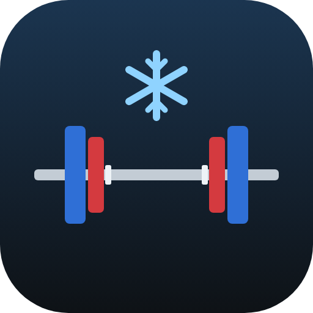
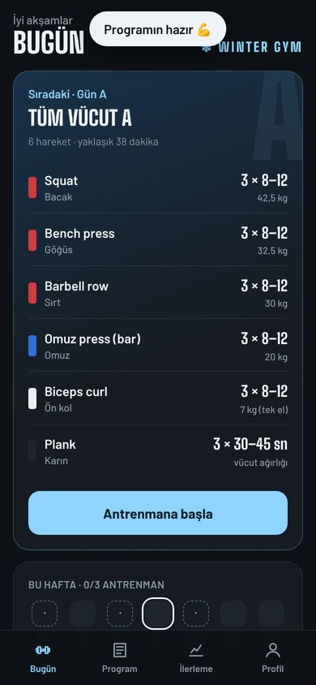
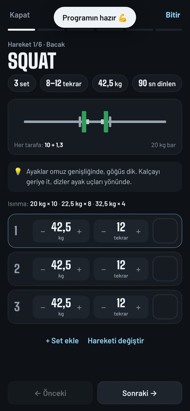
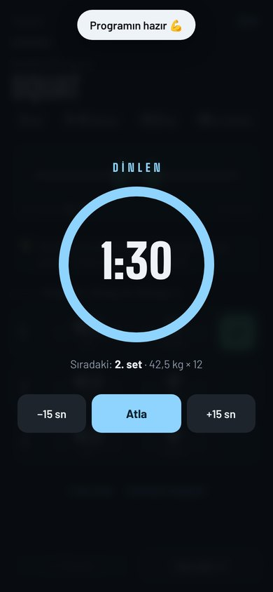
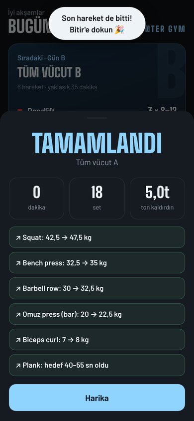
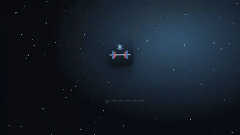

# Winter Gym

**Boyunu, kilonu ve hedefini gir; kaç set, kaç tekrar, kaç kilo yapacağını söylesin.**

   

<!-- ENS:TANITIM -->
## 🎬 Tanıtım

Tam kalitede izlemek için görsele tıkla · MP4, 51 saniye

<!-- /ENS:TANITIM -->

## Neler yapıyor?

- **Sana özel program:** Cinsiyet, yaş, boy, kilo, deneyim, hedef, haftada kaç gün ve ekipmana göre program çıkarır.
  - 2–3 gün: tüm vücut · 4 gün: üst / alt vücut · 5–6 gün: itiş, çekiş, bacak
  - Spor salonu, evde dambıl ya da sadece vücut ağırlığı
- **Kaç kilo?** Her hareketin başlangıç ağırlığı vücut ağırlığına ve deneyimine göre hesaplanır; bara takılacak plakaları renkleriyle gösterir.
- **Hedefe göre set ve tekrar:**

  | Hedef | Set × tekrar | Dinlenme |
  |---|---|---|
  | Kas yapmak | 3 × 8–12 | 90 sn |
  | Güçlenmek | 4 × 4–6 | 3 dk |
  | Yağ yakmak | 3 × 12–15 | 60 sn |
  | Genel form | 3 × 10–12 | 75 sn |

- **Antrenman modu:** Yaptığın seti tikle, dinlenme sayacı başlasın; süre bitince telefon titrer ve sıradaki seti söyler. Isınma setleri ve her hareket için kısa ipuçları var. Ekran antrenman boyunca kararmaz.
- **Ağırlık kendiliğinden artar:** Bir hareketin bütün setlerinde üst tekrar sayısına ulaşırsan, bir dahakine ağırlık bir kademe yükselir. İki antrenman üst üste zorlanırsan %10 hafifler.
- **Değiştir:** Bir hareketi sevmediysen ya da makine doluysa, aynı kası çalıştıran başka bir hareketle değiştir.
- **İlerleme:** Her hareketin ağırlık grafiği, son 12 haftanın düzeni, vücut ağırlığı takibi ve boy-kilo endeksi.
- İnternetsiz çalışır, hesap gerekmez; her şey telefonunda saklanır. Yedeğini indirebilirsin.

> Önerilen ağırlıklar genel bir başlangıç noktasıdır. Formu bozmadan yapabileceğin ağırlıkla çalış; bir hareket ağrı yaparsa dur. Sağlık sorunun varsa başlamadan önce doktoruna danış.

## Kurulum

**Android:** Yukarıdaki **APK indir** butonuna dokun, dosyayı aç. Telefon ilk seferde "bilinmeyen kaynaklardan yükleme" izni isteyebilir.

**Tarayıcı:** [enskygr234.github.io/Winter-gym](https://enskygr234.github.io/Winter-gym/) adresini Chrome'da aç, **⋮ → Ana ekrana ekle** de; uygulama gibi açılır.

## Teknik

- Düz HTML, CSS ve JavaScript; kütüphane yok. Program üretici ve ilerleme kuralları `program.js` içinde.
- Android sürümü [Capacitor](https://capacitorjs.com) ile paketlenir. Her yüklemede GitHub Actions APK'yı derleyip **Releases**'e koyar ve web sürümünü GitHub Pages'te yayınlar.
- Yazı tipleri: [Big Shoulders](https://github.com/xotypeco/big_shoulders) ve [Barlow](https://github.com/jpt/barlow), SIL Open Font License.

## Lisans

[MIT](LICENSE) © Enskygr234

<!-- ENS:ALT -->
---

**❄️ ENS Developer'ın diğer projeleri**

📱 Telefon: [Winterball](https://github.com/Enskygr234/Winterball) · [GolHaber](https://github.com/Enskygr234/golhaber) · [Yemek Tarifleri](https://github.com/Enskygr234/ensdewloper.github.io/tree/main/tarifler)

[🌐 Bütün projeler](https://enskygr234.github.io/ensdewloper.github.io/) · [👤 GitHub profilim](https://github.com/Enskygr234)

Kış gelir, kod yazılır.

<!-- /ENS:ALT -->
